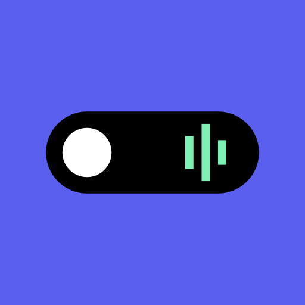
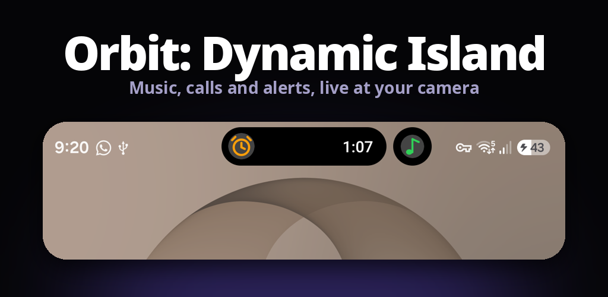
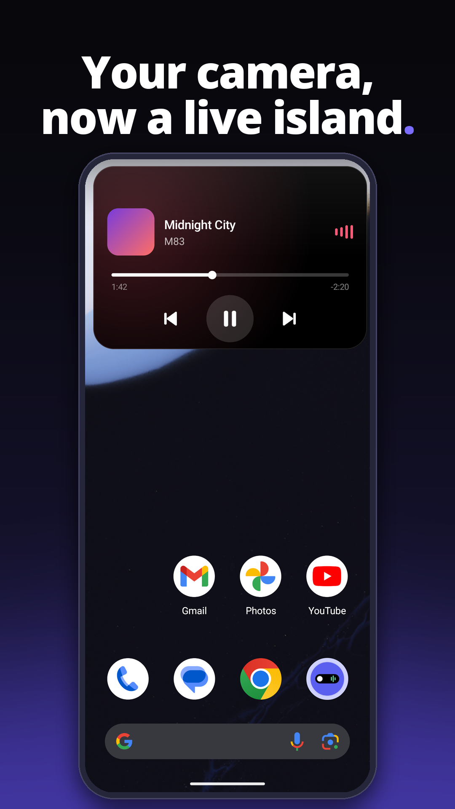
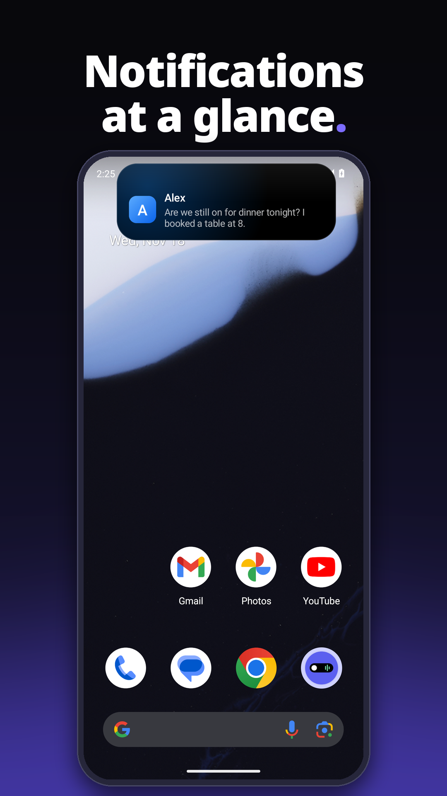
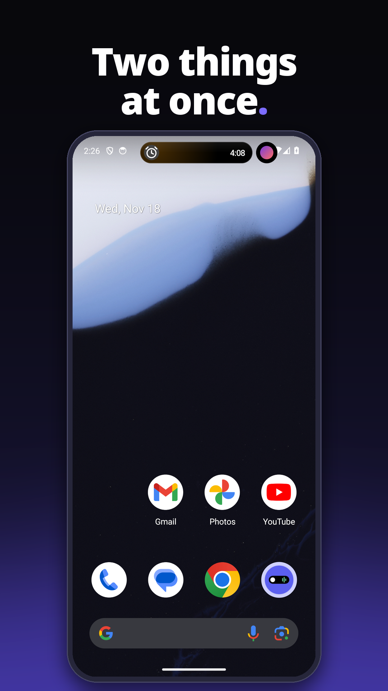
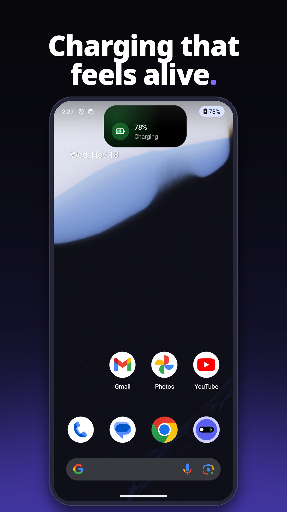
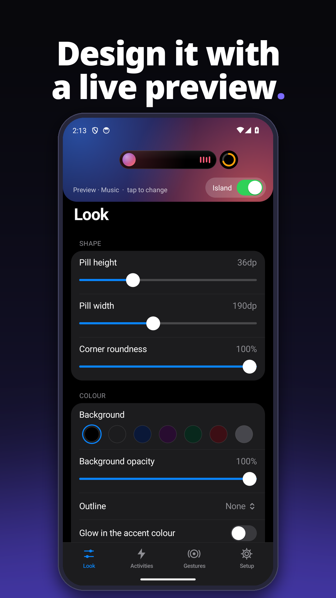
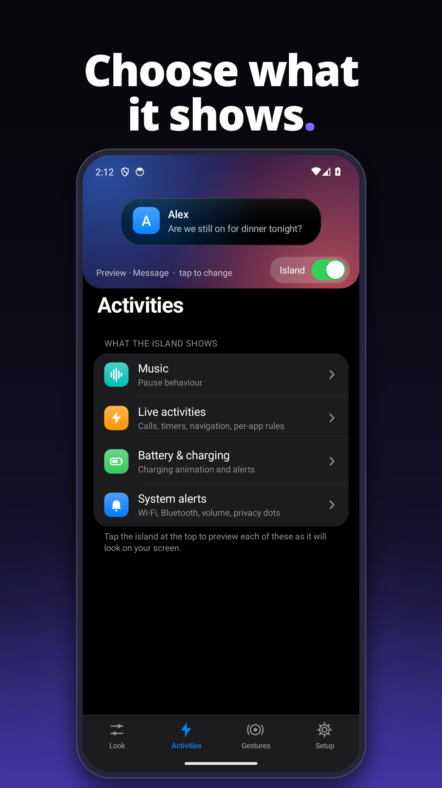
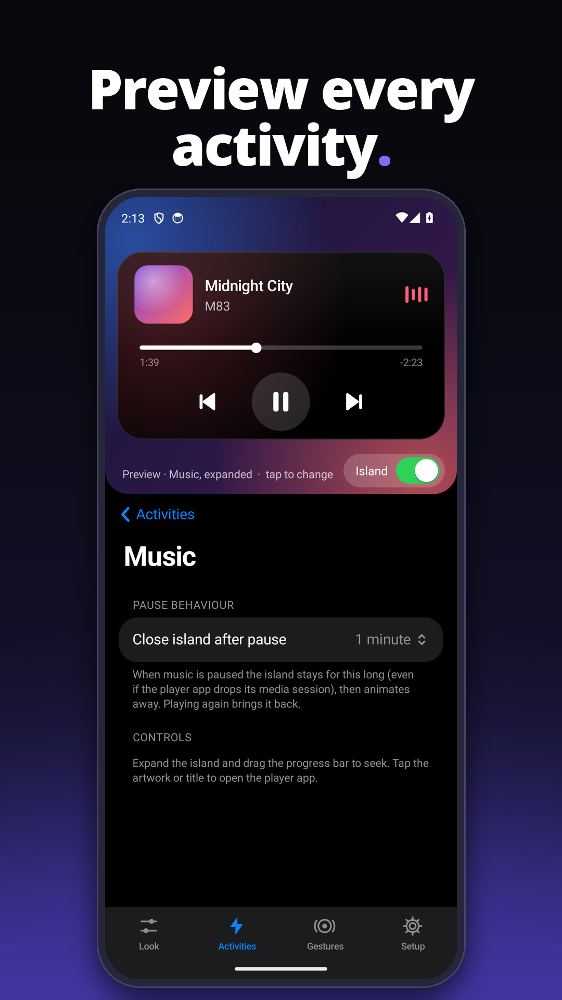
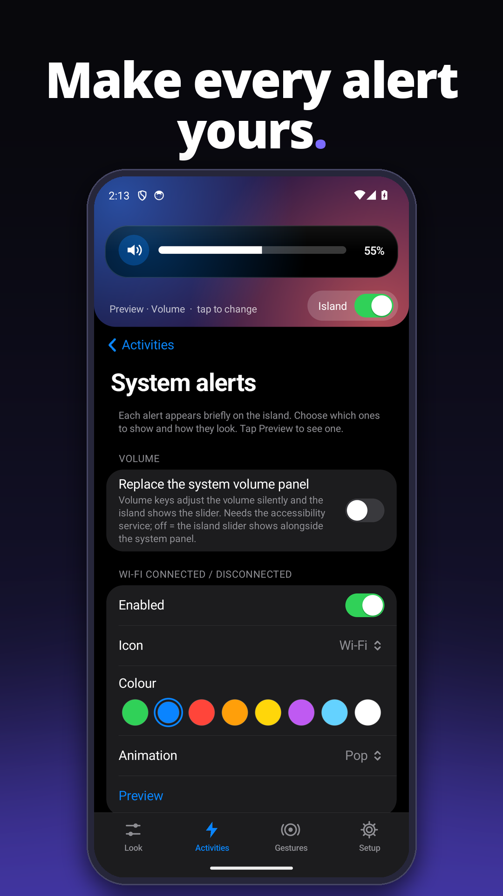

<div align="center">



# Orbit: Dynamic Island

**A live island around your Android phone's front camera.**
Music, calls, notifications, timers, navigation, charging and system alerts, in a small black pill at your camera. Tap it to expand, swipe it for actions, and make it yours.


[](https://github.com/BallbeIan/orbit/releases/latest)

**[Download the latest APK](https://github.com/BallbeIan/orbit/releases/latest)** · [Installing](#installing) · [Screenshots](#screenshots) · [Privacy](#privacy) · [Building](#building-from-source)



</div>

---

## What it does

- **It finds your camera.** Orbit detects where the front camera is on each screen, including **under-display cameras on foldables**, and centres itself on it. Foldables keep separate settings for each screen.
- **Live activities with working buttons.** Calls (Answer / Decline, timer, mute, speaker, hang up), timers and stopwatches, navigation, downloads and deliveries, alarms ringing. Notifications peek out and can be answered inline.
- **Two things at once.** When two activities are live, a second small pill splits off beside the first. Tap it and the pills trade places.
- **Fluid animations.** The island drops into the camera and comes back out like a water drop, expands on a soft spring, and swaps pills in three beats.
- **Settings with a live preview.** A real, working copy of the island sits at the top of every settings screen, so every change to the shape, colour or position shows at once.
- **Private by design.** The app **never asks for the internet permission**. Nothing leaves your phone. See [Privacy](#privacy).

| | |
|---|---|
| 🎵 **Music** | Album art, equalizer, expandable player with a draggable seek bar. Closes itself after a pause of your choosing. |
| 📞 **Calls** | Caller, Answer and Decline, running call timer, mute / speaker / hang up. |
| ⏱ **Timers & stopwatch** | A live count in the pill. Works with the standard Clock apps and Samsung's Clock. |
| 🧭 **Navigation** | Distance to the next turn in the pill, full instruction when expanded. |
| 🔋 **Battery** | Charging animation (fast / wireless, time to full), unplug, low, critical and full-charge alerts. |
| 🔔 **System alerts** | Wi-Fi, Bluetooth (with device name), hotspot, VPN, next alarm, volume slider, ringer mode, Do Not Disturb, airplane mode, NFC, mobile data, flashlight. Each with its own icon, colour and animation. |
| 🔴 **Privacy dots** | Microphone, camera and screen recording indicators. |
| 💬 **Notifications** | Short peeks with action buttons and inline reply. Choose per app: peek, live, or off. |

**Gestures.** Tap, double tap, long press and swipes in four directions can each run any action: expand, open the app, play / pause / skip, home, recents, back, screenshot, lock screen, notification shade, Quick Settings, flashlight, launch any app, or nothing. When the island is empty you can also assign an action to **tapping the camera itself**.

**Everyday controls.** Show the island only when something is happening (or always), set active hours, hide it on the lock screen, in chosen apps, **in full-screen apps** (video, games) or while the notification panel is open, and switch it on and off from a Quick Settings tile.

## Installing

**Google Play:** a Google Play release is planned.

**GitHub (signed APK):**

1. On your phone, open the [latest release](https://github.com/BallbeIan/orbit/releases/latest) and download `Orbit-<version>.apk`. Open it and allow your browser or file manager to install apps when Android asks.
2. Open **Orbit**. The Setup card on the home screen lists what it needs: tap **Grant** on **Notification access** (required) and **Accessibility service** (recommended), and agree to the explanation shown for each.
3. On Android 13 and newer, those two switches may be greyed out for an app installed outside the Play Store. Open **App info → ⋮ menu → Allow restricted settings**, then try again.
4. Play some music, start a timer, or toggle Do Not Disturb: the island appears around your front camera.

To check the download, compare its SHA-256 with the `.sha256` file on the release page. A newer APK installs over an older one and keeps your settings.

> [!IMPORTANT]
> The Google Play version and the GitHub APK are signed with different keys and **cannot update each other**. To switch from one to the other, uninstall Orbit first (your settings are lost).

**Requirements:** Android **8.0 (API 26) or newer**. Developed and tested on a **Samsung foldable (SM-F971B)**, inner and cover screens, and lightly on an Android 14 emulator. Behaviour on **Pixel and other phones has not been verified yet**: if you try it on one, please [open an issue](../../issues/new/choose) and say what worked.

## Screenshots

<table>
  <tr>
    <td></td>
    <td></td>
    <td></td>
    <td></td>
  </tr>
  <tr>
    <td></td>
    <td></td>
    <td></td>
    <td></td>
  </tr>
</table>

## Privacy

**Orbit collects nothing.** It has no internet permission, no ads, no analytics, no crash reporting and no third-party code. Everything it reads is used on your phone to draw the island and then thrown away. The full policy is in [docs/PRIVACY.md](docs/PRIVACY.md).

| Permission | Why |
|---|---|
| Notification access | Reads media sessions, notifications, calls, timers and progress so they can be shown. Processed on the device only. |
| Accessibility service | Draws the island above the status bar, performs gestures such as home and screenshot, knows which app is in front, and lists the on-screen windows to detect the notification panel and full-screen apps. It never reads what is on your screen. |
| Display over other apps | Fallback overlay when the accessibility service is off. |
| Unrestricted battery *(optional)* | The Setup card opens Android's battery list so Android doesn't close the island in the background. Orbit declares no permission for this. |
| Bluetooth, Location, Phone *(optional)* | Bluetooth device names, the Wi-Fi network name (Android requires location for it; Orbit never reads your location), and answering or ending calls as a fallback. |

The complete list is in [`AndroidManifest.xml`](app/src/main/AndroidManifest.xml).

## Building from source

You need JDK 17 and the Android SDK (platform 36, build-tools 36.0.0). In PowerShell:

```powershell
git clone https://github.com/BallbeIan/orbit.git
cd orbit
$env:ANDROID_HOME = "$env:LOCALAPPDATA\Android\Sdk"
.\gradlew.bat lint assembleDebug   # app\build\outputs\apk\debug\app-debug.apk
.\gradlew.bat assemblePreview      # installs next to the real app (app id suffix .preview)
```

On macOS or Linux, use `export ANDROID_HOME=~/Android/Sdk` and `./gradlew`. Or open the folder in Android Studio and run it on a device.

Release builds read signing from `keystore.properties` (see [`keystore.properties.example`](keystore.properties.example)). Without it they fall back to the debug key.

<details>
<summary><b>How it works</b></summary>

```
 NotificationListenerService ──┐                      ┌── MediaProvider       (music)
                               ├─►  IslandController ─┼── NotificationEngine  (calls, timers, nav, peeks)
 AccessibilityService ─────────┘   (priorities, rules)├── BatteryProvider
   · overlay window                      │            └── SystemAlerts        (Wi-Fi, BT, volume, ...)
   · window list (panel / full screen)   ▼
   · global gestures              IslandOverlay  ──►  pills, banners, expanded views, animations
```

- **`IslandController`** keeps a priority-ordered list of *activities*, decides which is the main pill and which is the small one, and applies the visibility rules.
- **Providers** turn Android signals into activities. Nothing polls: everything is callback-driven.
- **`IslandOverlay`** owns the window and all of the animation.
- **`CameraLocator`** reads the system cut-out, or the under-display-camera shape from the framework resources when the system reports none.
- No third-party libraries: the Android framework and Kotlin only.

| Path | What it does |
|---|---|
| `island/` | Controller, overlay, content views, icons, camera locator |
| `activities/` | Media, notification engine and builders, battery |
| `alerts/` | System alert detection and per-alert styling |
| `gestures/` | Touch handling and gesture actions |
| `settings/` | The settings app, per-screen preferences |
| `src/debug/` | Debug-only test hook (not in release builds) |

</details>

Bug reports and device reports are very welcome. See [CONTRIBUTING.md](CONTRIBUTING.md).

## Licence

Orbit is **source-available** under the [PolyForm Noncommercial License 1.0.0](LICENSE). You may read, learn from, modify and build it for personal and other noncommercial use. **Commercial use, including selling or publishing it on an app store, is not permitted without the author's permission.** A paid Google Play version is planned by the author.

Orbit is an independent project. It is not affiliated with, endorsed by, or sponsored by Apple Inc. "Dynamic Island" is a trademark of Apple Inc.
